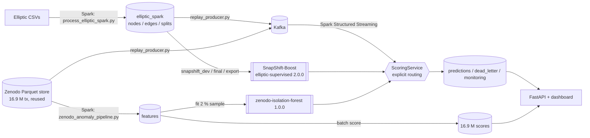

# Distributed Streaming Anomaly Detection on Blockchain Transaction Graphs

**Course:** 21CSC314P – Big Data Essentials · **Institution:** SRM Institute of Science and Technology (SRMIST) · **Faculty Guide:** Dr. Banu Priya Prathaban

**Team:** Rayaan Arora (`RA2411031010073`) · Faheem Mushtaq (`RA2411031010079`) · Lakshita Kumarkar (`RA2411031010091`) · Aarushi Sarkar (`RA2411031010099`)

An end-to-end pipeline that prepares Bitcoin transaction data with Apache Spark, trains and serves two anomaly models, replays transactions through Kafka into Spark Structured Streaming, scores them, persists the results and shows them on a dashboard. Everything below runs on one Windows workstation; every reported number links to the file that contains it ([`docs/VERIFIED_RESULTS.md`](docs/VERIFIED_RESULTS.md)).

## What it does, and what it does not

| | Status |
|---|---|
| Spark batch preprocessing of Elliptic (203,769 tx) and Zenodo (16.9 M tx) | ✅ implemented, run on the full data |
| Supervised illicit-transaction model on Elliptic: **SnapShift-Boost**, the project's own two-stage graph model, vs 12 baseline configs × 5 seeds | ✅ test illicit F1 **0.799** (baseline 0.797) |
| Unsupervised anomaly scoring of all 16.9 M Zenodo transactions | ✅ no labels exist, so no accuracy claim |
| Kafka → Spark Structured Streaming → scoring → Parquet, with checkpoints, de-duplication, dead letters, crash recovery | ✅ replay of stored data, integration-tested |
| Dashboard over the persisted outputs | ✅ |
| Live blockchain ingestion | ⛔ not implemented (replay only) |
| Temporal graph model | ⛔ the graph models see one time-step snapshot; nothing models temporal evolution |
| Distributed training / multi-node cluster | ⛔ single workstation; Spark is used for data preparation and streaming |
| Exactly-once end-to-end | ⛔ not claimed: at-least-once with idempotent sinks |

Full matrix: [`docs/IMPLEMENTATION_STATUS.md`](docs/IMPLEMENTATION_STATUS.md).

## Architecture



Details, components and graph-context handling: [`docs/END_TO_END_ARCHITECTURE.md`](docs/END_TO_END_ARCHITECTURE.md). Design decisions: [`docs/DECISIONS.md`](docs/DECISIONS.md).

### Batch vs replay vs live

* **Batch:** Spark jobs over files (Elliptic preprocessing, Zenodo features, full Zenodo scoring).
* **Replay streaming:** stored transactions are published to Kafka at a chosen rate and consumed by Spark Structured Streaming exactly as live events would be. This is what "streaming" means in this repository.
* **Live:** reading new blocks from a Bitcoin node or API. Not implemented.

## Datasets and their roles

| Dataset | Content | Role |
|---|---|---|
| **Elliptic** (`data/raw/elliptic`) | 203,769 transactions, 165 anonymised features, 234,355 edges, 49 time steps; 4,545 illicit, 42,019 licit, 157,205 unknown | Supervised benchmark. Train steps 1–29, validation 30–34, test 35–49. Unknown labels stay in the graph and never enter a loss or metric |
| **Zenodo record 7157854, part 2** (`data/parquet/zenodo_features`) | 16,889,271 reconstructed Bitcoin transactions, blocks 480000–489999 (built once in ~3.9 h; reused, never rebuilt) | Unsupervised anomaly scoring. No reliable illicit labels (an address-overlap study found too little overlap) |

The two models produce **different kinds of scores** and are never mixed: `illicit_probability` (Elliptic) vs `isolation_forest_anomaly_score` (Zenodo, "unusual", not "illicit"). Model cards: [`docs/MODEL_CARDS.md`](docs/MODEL_CARDS.md).

## Results

### Our model: SnapShift-Boost

A two-stage graph model. Stage 1 scores every transaction in a time-step snapshot. Stage 2 adds what stage 1 predicted for each transaction's **neighbours** (mean and max over in-, out- and all neighbours, plus the 2-hop mean). Training rows get out-of-fold stage-1 scores, so stage 2 never learns from a score fitted on its own label. Every feature is computed from one complete snapshot and is exactly node-order invariant, so streamed scores equal batch scores. Design, ablation and discussion: [`docs/SNAPSHIFT_BOOST.md`](docs/SNAPSHIFT_BOOST.md).

The components were chosen on rolling folds inside steps 1–34 by a rule fixed beforehand. Test steps 35–49 were read once:

| | Precision | Recall | Illicit F1 | ROC-AUC | AP | Recall steps 43–49 |
|---|---:|---:|---:|---:|---:|---:|
| **SnapShift-Boost (bundle 2.0.0, served)** | **0.888** | **0.727** | **0.799** | 0.932 | **0.800** | 0.024 |
| Best baseline: HistGBDT + neighbour aggregates (1.0.1) | 0.883 | 0.726 | 0.797 | **0.934** | 0.798 | 0.030 |

SnapShift-Boost is better on F1, precision, recall and AP, but the F1 gain (+0.003) is **not statistically significant** (95 % paired-bootstrap interval −0.005 to +0.011), and like every model here it fails after step 43. Of the three components tried, only neighbour-score propagation helped. Within-step feature ranks hurt, and a per-step Isolation Forest score was neutral.

### Elliptic baselines, test steps 35–49 (mean of 5 seeds; selection by validation only)

| Model | Precision | Recall | Illicit F1 | ROC-AUC | AP |
|---|---:|---:|---:|---:|---:|
| **HistGBDT + neighbour aggregates (selected baseline)** | **0.883** | 0.726 | **0.797** | 0.934 | 0.798 |
| HistGBDT, tuned | 0.887 | 0.718 | 0.793 | 0.938 | 0.799 |
| Ensemble HistGBDT + HistGBDT-with-GAT | 0.857 | 0.720 | 0.782 ± 0.022 | 0.940 | 0.799 |
| HistGBDT + cross-fitted GAT embeddings | 0.821 | 0.718 | 0.765 ± 0.028 | 0.939 | 0.795 |
| HistGBDT, earlier ablation settings (reproduces the earlier report) | 0.802 | 0.722 | 0.758 ± 0.029 | 0.940 | 0.794 |
| XGBoost, earlier settings | 0.630 | 0.743 | 0.682 | 0.928 | 0.789 |
| GAT alone | 0.490 | 0.494 | 0.492 ± 0.020 | 0.868 | 0.468 |

All 12 configurations, confusion matrices and per-step metrics: [`docs/VERIFIED_RESULTS.md`](docs/VERIFIED_RESULTS.md) §1. Main points:

* **Learned GAT embeddings do not beat plain gradient boosting** once stacking leakage is removed. The earlier "TGAT-BoostNet" fed the booster embeddings from a GAT trained on the same labels; with that leakage the hybrid scores 0.697.
* The differences among the top three models (< 0.03 F1) are **within threshold noise** and should not be read as a ranking.
* **Recall collapses after time step 43**: 0.85 on steps 35–42, 0.03 on steps 43–49. After step 43, illicit transactions look like training-period licit ones (only 6 % of their nearest training neighbours are illicit, vs 82 % before). The data has no timestamps, so it cannot confirm the dark-market-shutdown explanation from the literature.

### Zenodo (unsupervised)

16,889,271 transactions scored; stable across block ranges (PSI < 0.1 per 1,000 blocks); synthetic fan-in/fan-out anomalies are separated (AUROC 1.00 / 0.99) but subtle fee manipulation is not (0.49). Top-ranked real transactions are mostly 150-input → 1-output dust consolidations. A flag means "unusual", not "illicit". Report: [`data/validation/zenodo_anomaly/ZENODO_ANOMALY_REPORT.md`](data/validation/zenodo_anomaly/ZENODO_ANOMALY_REPORT.md).

### Performance (one workstation; not a cluster benchmark)

| Measurement | Value |
|---|---|
| Elliptic Spark preprocessing | 218 s |
| Zenodo Spark feature stage / full scoring of 16.9 M tx | 326 s / 2,319 s |
| Elliptic inference per ~5,000-node snapshot | baseline 33 ms (+24 ms graph-context construction); SnapShift-Boost 63 ms (two models; 13 µs per transaction) |
| Zenodo in-memory scoring | 12 ms per event; ~17–20k events/s in batches |
| Kafka → Spark → Parquet at 200 events/s | 217 events/s sustained, e2e p50 2.5 s, p95 4.8 s |
| Unthrottled replay | 937 events/s sustained (consumer-bound) |

"E2E" = producer send → prediction row written. Elliptic events additionally wait until their whole time-step snapshot has arrived (graph context), so their latency is dominated by snapshot completion.

## Setup (Windows PowerShell)

Requirements: Python 3.12, Java 8 JRE (Spark 3.5.0 and Kafka), ~10 GB free on D:. Exact versions: [`requirements.txt`](requirements.txt).

```powershell
python -m venv .venv
.venv\Scripts\python.exe -m pip install torch==2.14.1 --index-url https://download.pytorch.org/whl/cpu
.venv\Scripts\python.exe -m pip install -r requirements.txt
.venv\Scripts\python.exe scripts\fetch_spark_jars.py          # Kafka connector + pure-Java local FS (SHA-1 verified)
Copy-Item .env.example .env                                     # placeholders only; adjust paths
```

Kafka: unpack Apache Kafka 3.7.2 to the path in `BSAD_KAFKA_HOME` (see `.env.example`). Problems: [`docs/TROUBLESHOOTING.md`](docs/TROUBLESHOOTING.md).

## Quick start (one command)

With the prepared data and the model bundles in place, this runs the whole streaming pipeline:

```powershell
.venv\Scripts\python.exe scripts\run_pipeline.py
```

It starts Kafka, creates a fresh topic and run directory (`data\streaming\run_<timestamp>`), starts the Spark consumer, replays Elliptic steps 42–43 and 3,000 Zenodo transactions, and opens the dashboard on that run. Progress is printed until every event is scored. Press Ctrl+C to stop everything it started. Options: `--elliptic-steps 35 36`, `--zenodo-limit 5000`, `--rate 500`, `--no-browser`, `--exit-when-done`.

## How to run (individual stages)

The stages below rebuild every artifact from scratch. Steps 2 and 3 are slow and their outputs already exist.

```powershell
# 1. Elliptic through Spark, then parity/integrity checks (33 checks)
.venv\Scripts\python.exe scripts\process_elliptic_spark.py
.venv\Scripts\python.exe scripts\validate_elliptic_spark_parity.py

# 2. Train, select (validation only) and export the Elliptic model  (~1.5 h with 3 parallel workers)
.venv\Scripts\python.exe scripts\run_final_model_selection.py --train-only --seeds 42 789      # worker 1
.venv\Scripts\python.exe scripts\run_final_model_selection.py --train-only --seeds 123 2024    # worker 2
.venv\Scripts\python.exe scripts\run_final_model_selection.py --train-only --seeds 456         # worker 3
.venv\Scripts\python.exe scripts\run_final_model_selection.py --aggregate-only --model-version 1.0.2
.venv\Scripts\python.exe scripts\analyze_step43_shift.py

# 2b. SnapShift-Boost: component selection on steps 1-34 (3 folds in parallel, ~25 min), single test read, export 2.0.0
.venv\Scripts\python.exe scripts\snapshift_dev.py --fold 1      # also --fold 2 and --fold 3, in separate terminals
.venv\Scripts\python.exe scripts\snapshift_dev.py --summarise
.venv\Scripts\python.exe scripts\snapshift_final.py
.venv\Scripts\python.exe scripts\export_snapshift_bundle.py      # refuses to export unless 3 reproduction checks pass

# 3. Zenodo anomaly pipeline on the existing Parquet store (no raw reconstruction)
.venv\Scripts\python.exe scripts\zenodo_anomaly_pipeline.py features
.venv\Scripts\python.exe scripts\zenodo_anomaly_pipeline.py fit --model-version 1.0.1
.venv\Scripts\python.exe scripts\zenodo_anomaly_pipeline.py score
.venv\Scripts\python.exe scripts\evaluate_zenodo_anomaly.py

# 4. Kafka + Spark Structured Streaming replay
.venv\Scripts\python.exe scripts\local_kafka.py start
.venv\Scripts\python.exe scripts\local_kafka.py topics
# terminal A: consumer (continuous micro-batches; restart with the same --run-dir resumes from the checkpoint)
.venv\Scripts\python.exe scripts\streaming_consumer.py --run-dir data\streaming\demo --trigger "2 seconds"
# terminal B: producers
.venv\Scripts\python.exe scripts\replay_producer.py elliptic --steps 42 43 44 --rate 300
.venv\Scripts\python.exe scripts\replay_producer.py zenodo --block-chunk 487000-487999 --limit 4000 --rate 200

# 5. API + dashboard  ->  http://127.0.0.1:8000
.venv\Scripts\python.exe -m uvicorn src.api.app:app --host 127.0.0.1 --port 8000
```

Model versions are never overwritten: export refuses an existing version, and the scorer loads the highest version under `artifacts/models/<dataset>/` unless `BSAD_ELLIPTIC_BUNDLE` / `BSAD_ZENODO_MODEL` pin one. The dashboard reads `BSAD_STREAM_RUN_DIR` (default `data/streaming/demo`); the run selector switches between runs.

The unified scorer is also an HTTP endpoint: `POST /api/score` with canonical events ([`docs/DATA_SCHEMAS.md`](docs/DATA_SCHEMAS.md), JSON Schemas in [`docs/schemas/`](docs/schemas/)).

## Tests and benchmarks

```powershell
.venv\Scripts\python.exe -m pytest                                        # 92 unit tests, no infrastructure
.venv\Scripts\python.exe -m pytest tests\integration -m integration -v    # needs the local Kafka broker
.venv\Scripts\python.exe scripts\benchmark_scoring.py                     # in-memory latency
.venv\Scripts\python.exe scripts\run_streaming_benchmark.py --events 6000 --rate 200 --name rate200
.venv\Scripts\python.exe scripts\verify_saved_metrics.py                  # recompute earlier reported metrics
```

The integration suite covers delivery, dead-lettering, duplicate removal, restart from checkpoint, hard-kill recovery (0 lost / 0 duplicated), dashboard API, mixed-dataset routing and bit-identical stream-vs-batch Elliptic scores. The restart/kill test failed once in seven runs with an uncaptured cause.

## Limitations

1. Elliptic recall after time step 43 is ≈0.03; no model here handles that shift.
2. Validation (3,513 rows, F1 ≈ 0.97) barely separates strong models; thresholds are fragile (≈±0.03 F1).
3. Zenodo has no labels; flags are a review queue, and top-set membership varies between refits.
4. Zenodo address-history features come from the batch store; new blocks would need streaming address state.
5. Spark Python workers crash on this host, so streaming scoring runs in the Spark driver (`foreachBatch`).
6. Single plaintext Kafka broker on localhost; topic deletion disabled (Windows file-locking crash).
7. All measurements are from one Windows workstation.

## Repository map

| Path | Purpose |
|---|---|
| `src/spark/` | Spark session (Windows-safe), Elliptic Spark pipeline, Zenodo batch pipeline |
| `src/models/` | Elliptic training utilities, static GAT encoder, exportable bundle with `predict(nodes, edges)` |
| `src/anomaly/` | Zenodo features (Spark + identical pandas version) and Isolation Forest detector |
| `src/contracts/`, `src/scoring/` | Versioned event/prediction schemas, adapters, routing `ScoringService` |
| `src/streaming_replay/` | Kafka replay producer, Structured Streaming consumer |
| `src/api/` | FastAPI + dashboard |
| `scripts/` | Command-line entry points (see "How to run") |
| `tests/`, `tests/integration/` | Unit and infrastructure tests |
| `docs/` | Architecture, decisions, schemas, model cards, verified results, status, log |
| `data/validation/` | Reports and metrics produced by the scripts |

## Earlier work and corrections

Material from the course reviews is kept for reference (`Report_Review2_*`, `Review2_Blockchain_AML_Colab_Notebook.ipynb`, the `.pptx`, `data/validation/tgat_boostnet_*`, and the previous README at [`docs/history/README_before_2026-10-14.md`](docs/history/README_before_2026-10-14.md)). Corrections to claims made there:

* **"TGAT-BoostNet" was not temporal and was leaky.** Its GAT received only a scalar `t/49` (Elliptic edges never cross time steps) and the booster was trained on in-sample embeddings. Its reported numbers do recompute correctly from the saved predictions, but with leakage removed the GAT-hybrid does not beat tabular HistGBDT.
* The "77.3 % fewer false alarms" figure compared the hybrid with an untuned XGBoost on one seed; tuned tabular models have similar false-positive counts.
* The Review-2 Colab figures (1.69 ms micro-batch latency, 399,525 tx/s, Amdahl speed-up 3.12×) were in-memory or simulated, not end-to-end measurements. Measured end-to-end figures are above.
* The step-43 drop was previously attributed to the AlphaBay/Hansa takedown; the data cannot confirm a cause.

The Zenodo raw-data preprocessing results from that period remain valid and are the input to everything here: 10.86 GB of raw text (85.7 M records) → 16,889,271 transactions in 2.13 GB of Parquet, 13,977 s, validated with 0 null keys and 0 negative fees (`data/validation/zenodo_preprocessing_report.json`).

