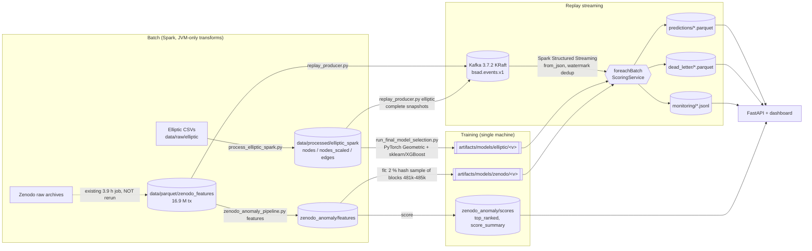

# End-to-end architecture

This describes what is implemented in the repository today. Planned or out-of-scope items are labelled as such.

## 1. Data flow

## 2. Components

| Component | Code | Runs on | Notes |
|---|---|---|---|
| Spark session factory | `src/spark/session.py` | local Spark 3.5.0, Java 8 | D:-only scratch, pure-Java local FS (DECISIONS D-03/D-04) |
| Elliptic preprocessing | `src/spark/elliptic_spark.py`, `scripts/process_elliptic_spark.py` | Spark | validation, id/label alignment, deterministic node order, edge mapping, chronological split, train-only scaler, native Parquet writer, staging + backup |
| Elliptic parity | `scripts/validate_elliptic_spark_parity.py` | pandas | 33 checks vs legacy pipeline and raw CSVs |
| Zenodo batch (existing) | `src/spark/zenodo_batch.py` | Spark + PyArrow writer | reused, not rerun |
| Zenodo features | `src/anomaly/zenodo_features.py`, `scripts/zenodo_anomaly_pipeline.py features` | Spark | 13 log-scaled features, row-level DQ status, hash sample bucket; identical pandas implementation for streaming |
| Zenodo detector | `src/anomaly/zenodo_detector.py` | sklearn | Isolation Forest + robust-z reason codes, versioned manifest + SHA-256 |
| Elliptic models | `src/models/elliptic_training.py`, `src/models/graph_encoder.py`, `scripts/run_final_model_selection.py` | PyTorch Geometric, sklearn, XGBoost | Baselines: 12 configurations, 5 seeds, validation-only selection; best `hgb_165_nbr` (bundle 1.0.1) |
| SnapShift-Boost (served Elliptic model) | `src/models/snapshift.py`, `scripts/snapshift_dev.py`, `snapshift_final.py`, `export_snapshift_bundle.py` | sklearn | Two-stage score propagation per snapshot, bundle 2.0.0 (`combine: two_stage`), see `docs/SNAPSHIFT_BOOST.md`, `docs/MODEL_CARDS.md` |
| One-command demo | `scripts/run_pipeline.py` | — | Starts Kafka, consumer, dashboard and producers for a fresh run; Ctrl+C stops them |
| Elliptic bundle | `src/models/elliptic_bundle.py` | | manifest, checksums, `predict(nodes, edges)` with explicit graph-context handling; node-order invariant (D-18) |
| Contracts | `src/contracts/schemas.py`, `adapters.py`, `docs/schemas/*.json` | pydantic v2 | event v1.0 (discriminated by `source_dataset`), prediction result v1.0 |
| Unified scorer | `src/scoring/service.py` | | routing by validated event type, never cross-dataset |
| Kafka | `scripts/local_kafka.py`, `infra/kafka/server.properties` | Kafka 3.7.2 on Java 8 | single node, plaintext, 127.0.0.1:29092 |
| Producer | `src/streaming_replay/producer.py`, `scripts/replay_producer.py` | confluent-kafka | deterministic order, stable keys, rate limit, idempotent producer |
| Consumer | `src/streaming_replay/consumer.py`, `scripts/streaming_consumer.py` | Spark Structured Streaming | checkpointed offsets, watermark dedup, DLQ, snapshot state, per-batch atomic files |
| API + dashboard | `src/api/app.py`, `src/api/static/index.html` | FastAPI/uvicorn | reads persisted outputs only; `/api/score` exposes the scorer |

## 3. Batch vs replay vs live

| Mode | What it is here | Status |
|---|---|---|
| Batch | Spark jobs over files (Elliptic preprocessing, Zenodo features, full Zenodo scoring) | Implemented and run on the full datasets |
| Replay streaming | Existing Parquet → Kafka → Spark Structured Streaming → scoring → Parquet | Implemented, integration-tested, benchmarked locally |
| Live ingestion | Reading new blocks from a Bitcoin node or API | **Not implemented.** No live source exists in the repo |

## 4. Graph context and state

* **Elliptic**: a transaction's graph context is its whole time-step snapshot (edges never cross steps). Events carry `snapshot_id`, `snapshot_size` and `out_neighbors`. A graph-dependent exported model scores only complete snapshots (buffered across micro-batches in `<run>/state/elliptic_snapshots/`). Incomplete snapshots expire after N batches with status `rejected_incomplete_graph_context`. A tabular-only exported model scores immediately.
* **Zenodo**: address-history features were computed causally at preprocessing time (`rowsBetween(unboundedPreceding, -1)`). The stream carries them as attributes. No live address-history state is maintained. Extending it to new blocks would require address-level state, which is not implemented.

## 5. Delivery semantics

At-least-once batch execution (Kafka offsets in the Spark checkpoint), idempotent per-batch prediction files, a 30-minute watermark de-duplication in Spark, and a sink-side `event_id` index. Exactly-once is **not** claimed (see DECISIONS D-15).

## 6. Deployment shape (verified)

One Windows 11 workstation (16 logical CPUs). Spark `local[2]` to `local[4]`, one Kafka broker, one consumer process, one API process. Nothing here demonstrates multi-node scaling.
